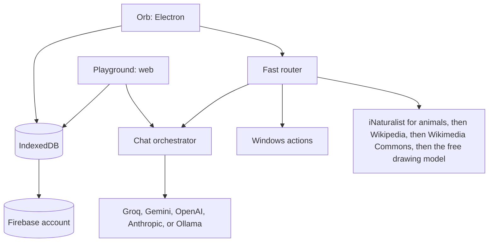

# FloatGPT architecture

**Version:** 2.3.1 for Windows. The macOS build remains 2.1.2.  
**Author:** Mayank Garg

This is the working architecture of FloatGPT. It is written so a résumé line can be checked against the code. Timings in older drafts of this file were estimates. They are not measurements, and they are not repeated here.

## 1. Two surfaces

FloatGPT is one product with two windows that do not share a chat transcript.

| Surface | Where it runs | What it owns |
| --- | --- | --- |
| Orb | Electron 33, React 19, Vite on port 3000 | The floating window, desktop actions, voice, and the Orb conversation |
| Playground | Vite on port 5173, published at floatgpt.vercel.app | Sign-in, plans, API keys, the Guide, and the Windows download |

They share a memory layer for plans and settings. An Orb transcript does not overwrite a Playground transcript.

`npm run dev` starts the web server, the Playground, and Electron together.

## 2. How a message is handled

The path is fixed. A later step does not run when an earlier step already answered.

1. **Confirmed desktop jobs**, only when Plan mode is off. An email becomes a mailto draft. A form is filled and Submit is left unpressed. A Cursor prompt is pasted and Enter is left unpressed. Passwords are refused. Each job waits for a later “send” or “submit”.
2. **Fast router** (`src/ai/fastRouter.ts`). Clock, memory, opening an app, and opening a Settings page are answered on the machine. Typed “open apps in setting” opens Apps in Settings. These requests do not spend a model call.
3. **Pictures** (`src/chat/imagePainter.ts`). A known subject is looked up. An original scene is drawn. See section 3.
4. **Chat model.** What remains goes to the provider selected for that chat.

A miss or a crash returns a short line. It does not fall through into another command.

## 3. Pictures

No OpenAI or Gemini image key is used. Saved chat keys are not sent to an image API. Groq does not draw.

| Request | Source | Why |
| --- | --- | --- |
| A tiger, a lion, a bald eagle | iNaturalist research photo | Used only when the words are exactly an animal species’ common or scientific name. The photo must carry a Creative Commons or public domain license. Plants, people, and loose matches such as “peacock” go to Wikipedia. |
| Lord Rama, the Taj Mahal, the Indian flag, a peacock, a named person | Wikipedia lead image | The exact words are looked up first, following Wikipedia’s own redirects, so “Indian flag” opens Flag of India and “peacock” opens Peafowl. A search is tried next. Disambiguation pages and fair use files are skipped. The license and artist are read from the file. |
| A known subject with no Wikipedia image, such as Shin-chan | Wikimedia Commons | The file title must name the subject. A train, a station, a cake, a pillow, a costume, or a logo that merely contains the name is skipped. A trademark notice on a freely licensed drawing does not hide the drawing. |
| A red house on a quiet street, or a house | Free drawing model on Pollinations | A search cannot create a scene that nobody has photographed. Plain everyday words are drawn too, because their encyclopedia pictures are often historic, such as a 1925 Ford for “car”. |

The picture is shown in the chat with the source, the license, and the artist under it. If every lookup misses, the free model still draws. Wikimedia requests name the app in the `Api-User-Agent` header, and a rate limited answer is retried once. A busy or failed lookup is never remembered as “no picture”, so the next request asks again. The free drawing service allows about one picture every 15 seconds and sometimes reports that it is busy, so a failed drawing waits and tries again twice before it says it failed. Empty `/image` shows help and does not search.

## 4. Voice and the composer

Speech is dictation into the focused field. There is no Wispr SDK and no call to a closed voice API.

- A finished spoken burst uses the same send path as the mic.
- Slow typing does not send the message.
- Enter sends. Shift+Enter starts a new line. The composer is a text area and grows for a few lines.
- The mic is not left listening after the burst.

## 5. State

| Data | Where it lives |
| --- | --- |
| Orb chats, Playground chats, API keys | IndexedDB on that device, through `idb-keyval` |
| Plans, tasks, and settings for the account | Firebase, after the local write |
| Download count | MongoDB `downloads` rows, added to a fixed previous total. Opening the app does not increment the public Windows number. |

Local read and write happen first. A completed task is not moved back to planned by a later remote copy. Account sign-in is email or Google. Chat text is not the thing that follows the account.

## 6. Models

| Provider | Role |
| --- | --- |
| Ollama, Qwen 2.5 Coder 7B | Chat with no API key. The model is about 4.7 GB. `npm install` does not download it. |
| Groq, Gemini, OpenAI, Anthropic | Cloud chat when a key is saved on the device. A rate limit moves to the next saved key for that provider. |
| Pollinations Flux | Free drawing for an original scene only. |
| iNaturalist, Wikipedia, and Wikimedia Commons | Free pictures of a known subject. No API key. |

RAM and the active window are read on the PC. The model is not asked to invent those numbers.

## 7. Desktop safety

The cloud model can propose a PowerShell script for an ordinary OS action, such as opening an app or changing volume. `src/agent/securityGuard.ts` reads the script before it runs.

- Obfuscation is stripped before the check, including escaped command names.
- Deleting system locations, formatting a drive, and the same class of destructive command are blocked.
- The user can run a blocked command themselves. FloatGPT does not run it.
- The focus guard (`electron/guardian.cjs`) polls the active window title. A title on the blocklist brings the orb forward. Red on the orb is reserved for that, and for an extreme deadline.

## 8. Playground and the installer

The public site and the local Playground explain two ways to use FloatGPT.

- **Windows app.** Version 2.3.1, 64-bit, about 100 MB. The download button shows the count, then “Download for Windows”. The GitHub asset is `FloatGPT.Setup.2.3.1.exe`.
- **Open source on this PC.** Node.js 20 or newer, then Ollama if cloud chat is not wanted. The Guide uses the same steps.

The packed file name from `npm run pack:win` uses spaces: `FloatGPT Setup 2.3.1.exe`. The published asset uses dots.

Version 2.3.1 adds PreBrief executive pre-meeting intelligence powered by Tavily, Flowtion multi-block PDF dossiers, and Home tools (WhatsApp scheduling, price comparison, Flowtion local notes).

## 9. Stack

| Layer | Choice |
| --- | --- |
| Desktop | Electron 33 |
| Interface | React 19, Vite 6, Tailwind CSS 4, Motion |
| Language | TypeScript |
| UI state | Zustand |
| Local store | `idb-keyval` |
| Account | Firebase Authentication and Firestore |
| Download records | MongoDB, behind the Playground API |
| Local model | Ollama |
| Tests | `tsx` suites for hands, image selection, OS launch, the messenger, and the platform phases. `npm test` runs the checked-in suite. |

## 10. Résumé lines

Copy these as they are. If an interviewer asks for a number, describe the path in sections 2 and 3. Do not add a latency or a percentage that this file does not measure.

### Full-stack

- Built FloatGPT, a Windows desktop assistant in Electron 33, React 19, and TypeScript. The orb stays above other windows and returns with a global hotkey. A separate web Playground handles sign-in, the guide, and the installer.
- Split device data from account data. Chats and API keys stay in IndexedDB. Plans and settings follow the Firebase account. Orb chats and Playground chats stay separate.
- Shipped FloatGPT 2.3.1 for Windows, with PreBrief executive intelligence powered by Tavily, Flowtion PDF dossiers, and Home tools for WhatsApp scheduling, price comparison, and notes, plus a public download page that offers the installer or a local run on Node 20 and Ollama.

### AI systems

- Routed app launch, Settings, and memory questions on the PC before any model call, and sent the remaining chat to Groq, Gemini, OpenAI, Anthropic, or a local Qwen model.
- Built a free picture path. An animal species comes from an iNaturalist research photo, other known subjects from the Wikipedia lead image, then from a Wikimedia Commons file whose title matches. An original scene is drawn. Paid image APIs are not called.
- Held email send, form submit, and Enter in Cursor until a later confirmation. Plan mode does not run those actions.

### Systems

- Classified generated PowerShell before execution and blocked destructive commands, including deletes under system directories and drive formats.
- Watched the active window title from a background Windows process and brought the assistant forward when a blocked title was in front.
- Covered image selection, OS launch, and the confirmation path with automated tests so a train photo cannot pass as a cartoon character and a scene request is not treated as a web lookup.

## 11. Interview map

| They ask | Walk here |
| --- | --- |
| Why two apps? | Section 1. The orb is the desktop. The Playground is the account and the download. |
| How do you avoid paying for every message? | Section 2. The fast router answers the machine questions. |
| How do pictures stay free and legal to show? | Section 3. Wikipedia and Commons carry a license. A search hit that is the wrong object is rejected. A new scene is drawn. |
| How do you stop the model from deleting files? | Section 7. The script is classified before it runs. |
| What stays on the laptop? | Section 5. Chats and keys. |
