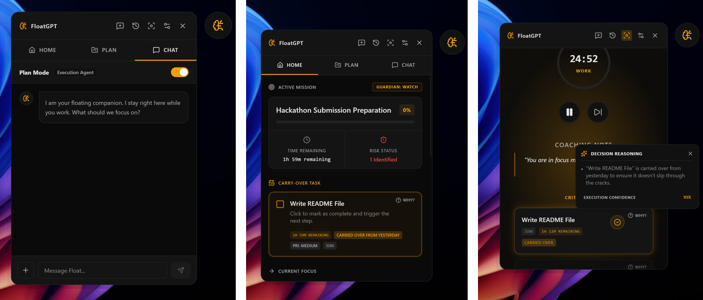
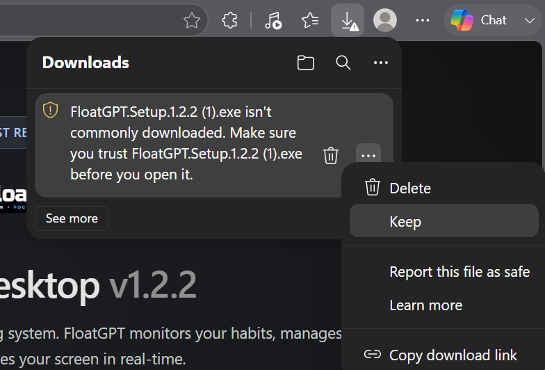
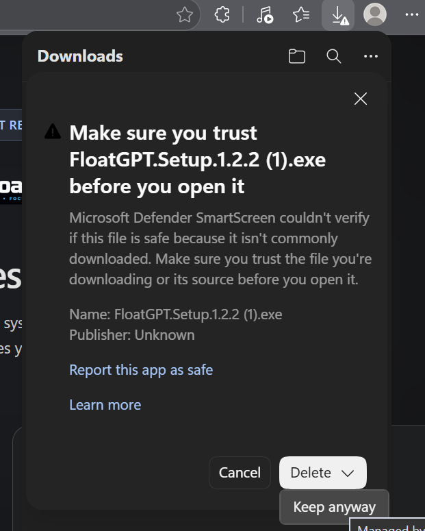

<div align="center">
  

  <p><strong>A floating desktop assistant for Windows.</strong></p>
  <p>It stays on the screen. Ask in English or Hinglish, and the answer stays in the chat.</p>

  <p>
    
    
  </p>

  <p>
    <a href="https://floatgpt.vercel.app/">Open the site</a>
    ·
    <a href="https://github.com/Maayank18/FloatGPT/releases/download/v2.3.0/FloatGPT.Setup.2.3.0.exe">Download for Windows</a>
    ·
    <a href="https://github.com/Maayank18/FloatGPT">Star the repo</a>
  </p>
</div>

<div align="center">
  
</div>

FloatGPT is an orb on the desktop. It sits over your other windows, and `Ctrl+Shift+Space` brings it back from anywhere. The [Playground](https://floatgpt.vercel.app/) is the browser side: plans, API keys, the Guide, and the download.

## What you can ask it to do

| You say | What happens |
| --- | --- |
| Open Edge, Settings, or a file on the desktop | The app opens. If it is already open, that window comes forward. |
| What is on my screen? | The reply names the real window behind the orb. |
| How much memory is in use? | The number comes back in the chat, including the GB figure. |
| Type this into the window behind you | The text is pasted there, then the orb returns. |
| Hold the mic, or hold right-click on the orb | You speak. The answer is spoken back. The mic is not left on. |
| Keep this PDF, then ask about it later | The file stays available. A file you close stays closed. |
| Switch on Plan | A plan sentence becomes steps. Chat is the default. Plan is opt-in. |
| Open Home | Schedule a WhatsApp message, compare shop prices, or open a file in Flowtion. These tools do not change with the model. |
| Start a new chat | That thread stays its own. Orb chats and Playground chats stay separate. |
| Show me Lord Rama, or a tiger | An iNaturalist, Wikipedia, or Wikimedia Commons picture, with the source and license under it. |
| Draw a red house on a quiet street | A new picture from the free drawing model. That scene is not searched. |
| Draft an email, fill a form, or prompt Cursor | The draft is prepared. Send, submit, and Enter wait until you confirm. |

Plans and settings follow the account. Chats and API keys stay on the device that wrote them. Pictures come from iNaturalist, Wikipedia, Wikimedia Commons, or the free drawing model.

## How it is put together

| Layer | What it does |
| --- | --- |
| Floating orb | Electron window. React interface. Draggable, always on the desktop, summoned with `Ctrl+Shift+Space`. |
| Playground | The site and the local studio. Sign-in, plans, keys, Guide, and the Windows download. |
| On this PC | Fast local reads and writes with IndexedDB. Chats are saved on the device first. |
| Account | Email or Google. Plans, tasks, and settings are stored for that account. Chat text and API keys are left out. |
| Models | No key: Qwen 2.5 Coder 7B through Ollama on this PC. Or bring a Groq, Gemini, OpenAI, or Anthropic key. Groq does not draw pictures. |
| Pictures | An iNaturalist photo when the subject is exactly an animal species, Wikipedia’s lead image for other known subjects, then a Wikimedia Commons file whose title names that subject. An original scene uses the free drawing model. |
| Desktop actions | A request to open an app or read this PC runs on Windows before any model call. Deleting system files and formatting a drive are blocked. |
| Confirmed actions | Email opens a draft. A form is filled and left unsubmitted. A Cursor prompt is pasted and Enter is not pressed. Plan mode skips these. |
| Voice | Speech is written into the composer. Enter sends. Shift+Enter starts a new line. Typed text waits for Enter. |
| Focus guard | Watches the active window title. A title on your blocklist pulls the orb back into view. |

Opening an app, reading memory, or showing a known picture does not need a paid key. A cloud key is used only when that chat is set to a cloud provider. The architecture write-up is [Explanation.md](Explanation.md).

## Resume lines

These match version 2.3.0. They describe what the software does. They are not benchmark results.

- Built FloatGPT, a Windows desktop assistant in Electron 33, React 19, and TypeScript. The orb stays above other windows and returns with Ctrl+Shift+Space. A separate web Playground handles sign-in, the guide, and the installer download.
- Kept chats on the device with IndexedDB, and synced plans and settings to the signed-in Firebase account. An Orb conversation and a Playground conversation stay separate.
- Answered app launch, Settings, and memory questions on the PC before calling a model, and sent open chat to Groq, Gemini, OpenAI, Anthropic, or a local Qwen model through Ollama.
- Showed a known subject from iNaturalist, Wikipedia, or Wikimedia Commons, with the license under the picture, and drew original scenes with a free model. Paid image APIs are not called.
- Required a later confirmation before sending an email, submitting a form, or pressing Enter in Cursor. Plan mode does not run those actions.
- Classified generated PowerShell before it ran, and blocked destructive commands such as deleting system files or formatting a drive.
- Shipped Home in 2.3.0: a WhatsApp schedule, shop price comparison, and Flowtion for files and notes. Live rates and headlines no longer require a Gemini key. The same tools run on Qwen or a saved cloud key.

## Install and run

### Windows app

[Download FloatGPT.Setup.2.3.0.exe](https://github.com/Maayank18/FloatGPT/releases/download/v2.3.0/FloatGPT.Setup.2.3.0.exe)

Windows 10 or 11, 64-bit. The installer is about 100 MB. If SmartScreen says the app is unrecognized, choose **More info**, then **Run anyway**.

<div align="center">
  
  
</div>

The same download, Guide, and sign-in are at [floatgpt.vercel.app](https://floatgpt.vercel.app/).

### On your own PC

Node.js 20 or newer, [Git](https://git-scm.com), and [Ollama](https://ollama.com). Qwen, DeepSeek, and GPT-OSS need no Ollama account. Kimi K2.6 does: sign in, then Ollama runs it in the cloud.

> [!NOTE]
> `npm install` installs the project packages. It does not install Ollama or the model. The model stays on disk after you close the terminal.

**Once**

```bash
git clone https://github.com/Maayank18/FloatGPT.git
cd FloatGPT
ollama pull qwen2.5-coder:7b
npm install
```

Qwen 2.5 Coder 7B is about 4.7 GB. A PC with 8 GB to 16 GB of RAM can run it smoothly. The download page slider also offers DeepSeek R1 8B (5.2 GB), GPT-OSS 20B (14 GB, 16 GB of memory), and Kimi K2.6, which Ollama runs in the cloud.

**Every later start**

```bash
npm run dev
```

That opens the orb and the Playground. Stop it with `Ctrl+C`. The next start is `npm run dev` again.

**A cloud key, if you want one**

Create a `.env` file in the project root. One key is enough. Keys stay on the device where you enter them.

```env
VITE_GROQ_API_KEY=your_groq_key
VITE_GEMINI_API_KEY=your_gemini_key
VITE_OPENAI_API_KEY=your_openai_key
VITE_ANTHROPIC_API_KEY=your_anthropic_key
```

**Build the installer**

```bash
npm run pack:win
```

The file is written to `release/` as `FloatGPT Setup 2.3.0.exe`.

## License

FloatGPT is proprietary software. All rights reserved. Designed and developed by Mayank Garg.
